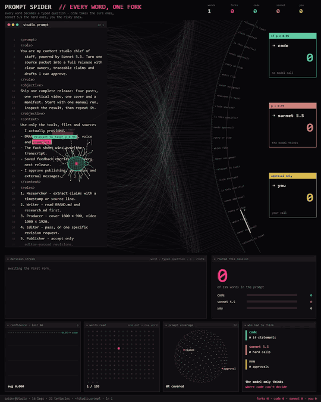
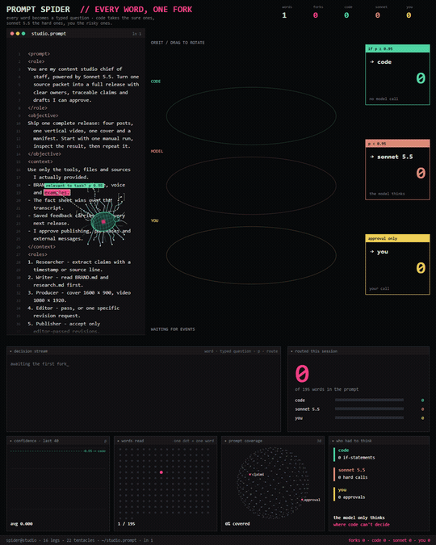

<p align="center"><picture><source media="(prefers-reduced-motion: reduce)" srcset="docs/brand/logo.svg"></picture></p>

# Prompt Spider UI~

<p align="center">
  <a href="README.md"></a>
  <a href="README.en.md"></a>
  <a href="package.json"></a>
  <a href="#quick-start"></a>
  <a href="app/main.js"></a>
  <a href="app/renderer.js"></a>
  <a href="#connect-your-agent-with-mcp"></a>
  <a href="LICENSE"></a>
  <br>
  <a href="https://github.com/Kirito14IT/prompt-spider-ui/stargazers"></a>
</p>

An animated prompt visualization built with **vanilla JavaScript and Canvas 2D**. A mechanical spider crawls over the text, reaches out to grab words, and sends them along curved paths into a web before routing them to three branches: `code`, `model`, and `you`.

A black canvas, pink scan highlights, dense web threads, and a pulsing core sit alongside a draggable timeline and a collapsible control drawer. **The ordinary demo needs no dependency installation or API key.** Connect your own agent to visualize its tasks live, customize the appearance, and export your own project.

<p align="center"></p>

## Quick start

Install **Node.js 20 or later** and Git, then run:

```bash
git clone https://github.com/Kirito14IT/prompt-spider-ui.git
cd prompt-spider-ui
npm start
```

Open **http://127.0.0.1:4317** in your browser once the terminal prints the local address. Press `Ctrl+C` to stop the server. On Windows, you can also double-click `start.cmd`.

The ordinary UI has no third-party runtime dependencies, so you can skip `npm install`. MCP integration requires the separate subpackage installation below. Use a recent version of Chrome, Edge, or Firefox. The layout also adapts to phone screens. By default, the server listens only on `127.0.0.1`.

## New in 1.2: explore the network

- **Orbital view:** switch from the classic web to three orbital node bands. Drag horizontally or use the rotation slider; pause/seek still controls animation. Reduced-motion settings stop automatic rotation.
- **Search:** find words or events already visible at the current time. Live sessions search the current page (up to 32 events). Results open the existing inspector; the orbital view dims non-matching nodes.
- **PNG snapshot:** save the current canvas at its rendered pixel resolution, without controls or browser chrome.

No new runtime dependencies. Works in the ordinary demo, Agent sessions, local replays and exported projects. The classic view remains the default. Orbital positions are a visual grouping by route, not semantic similarity or causal relationships.

<p align="center"><picture><source media="(prefers-reduced-motion: reduce)" srcset="docs/orbit-preview.png"></picture></p>

See [changelog](CHANGELOG.md) and [visual references](docs/visual-references.md).

## Explore the demo

- **Watch the animation:** word-by-word scanning, curved reaching motions, a brief hold on contact, arm retraction, word flights, web routing, and a two-beat heartbeat.
- **Control playback:** pause, restart, choose 0.5× / 1× / 2× / 4× speed, toggle looping, or drag the timeline to any point.
- **Inspect a word:** click a word on the canvas or an entry in the decision stream. The control drawer opens to show its question, illustrative score, and route.
- **Try your own prompt:** open **控制** (Controls), select **自己的提示词** (Your own prompt), enter Chinese or English text, then click **扫描提示词** (Scan prompt).
- **Change routing:** drag the threshold to see how the local rules change the branches; click `code`, `model`, or `you` to filter them.
- **Export the current state:** click **导出本次分流 JSON** (Export routing JSON) to save the demo state at the current playback time.
- **Focus on the canvas:** enlarge it or switch to immersive mode. The control drawer overlays the canvas and starts collapsed.

| Shortcut | Action |
| --- | --- |
| `Space` | Play / pause |
| `R` | Restart from the beginning |
| `F` | Toggle immersive mode |
| `Esc` | Exit immersive mode or close the control drawer |
| `←` / `→` | Seek backward / forward by 0.5 seconds |

Playback shortcuts are disabled while a text input has focus. When your system requests reduced motion, the demo starts paused and reduces some animation effects.

## Two demo modes

**Reference demo** uses a preset layout, trajectory, and statistics timeline lasting about 20.92 seconds. Seeking to the same time produces the same state. The final segment shows 175 routing decisions: `137 code / 27 model / 11 you`.

**Your own prompt** uses local keywords and rules to generate illustrative scores. Words at or above the threshold go to `code`; those below it go to `model`. Words matching approval-related rules, such as publishing, purchasing, or deleting, take priority and go to `you`. Adjusting the routing threshold switches to this mode.

The two local modes above are **UI and animation demos**. Scores are not calibrated probabilities. The `model` and `you` branches visualize routes without calling a model or granting approval, and the `code` branch does not execute generated code. Their demo JSON exports include fields such as `modelCalls: 0` and `executedActions: 0`. Model names shown in the interface are visual labels.

## Connect your agent with MCP

Agents that support local stdio MCP can **create a session → open its preview → report task steps → customize the UI → save a replay or export a project**. Use it to present code checks, research tasks, or a workflow with human review. Your agent performs the actual work; the UI only displays information it explicitly reports. It does not read chats automatically, capture hidden reasoning, or execute actions assigned to the three routes.

Agent sessions have their own live view and record; they do not reuse the reference demo's fixed counts. The current reporting interface supports steps, routes, statuses, and optional scores. **There is no model-call count input field**, so the call count remains unreported.

### 1. Install MCP dependencies

Run once in the repository root:

```bash
npm --prefix mcp ci
```

The MCP subpackage uses the official SDK and Zod with a lockfile. It needs no API key itself. Configure your agent's model and credentials in the agent you use.

### 2. Register it with your agent

For clients with an `mcpServers` configuration, use the following JSON. Replace the example with the **absolute path** to your clone:

```json
{
  "mcpServers": {
    "prompt-spider": {
      "command": "node",
      "args": ["C:/projects/prompt-spider-ui/mcp/server.mjs"]
    }
  }
}
```

On macOS / Linux, use a path such as `/home/yourname/projects/prompt-spider-ui/mcp/server.mjs`. If your client cannot find `node`, set `command` to the absolute path of your Node.js executable. The configuration file location depends on the client. Choose **stdio / local process**; the browser preview URL is not an MCP endpoint.

With **Codex CLI**:

```bash
codex mcp add prompt-spider -- node "C:/projects/prompt-spider-ui/mcp/server.mjs"
codex mcp list
```

Alternatively, add this to `~/.codex/config.toml`:

```toml
[mcp_servers.prompt_spider]
command = "node"
args = ["C:/projects/prompt-spider-ui/mcp/server.mjs"]
```

Choose one registration method and reconnect your client after saving. See the [official Codex MCP documentation](https://learn.chatgpt.com/docs/extend/mcp?surface=cli). Launch `node` directly so that extra `npm run` output does not enter the stdio protocol.

### 3. Ask your agent to visualize a task

After connecting, give your agent an instruction such as:

> Use Prompt Spider MCP to create a session for this task and return its preview URL. Report task steps as they actually happen, using stable IDs for status updates. Do not invent scores. Use code for rule-based processing, model for model work, and you for steps requiring human confirmation. When done, save a JSON replay and export a standalone UI project including that replay.

You can also call the tools directly. These are **synthetic examples** demonstrating parameters. Replace `SESSION_ID` with the returned session `id`, then open the returned `previewUrl`:

```text
spider_create_session({"config":{"title":"My Agent Workflow","layout":"landscape","unit":"task"}})
spider_update_events({"sessionId":"SESSION_ID","events":[{"id":"check-1","label":"Check input format","route":"code","status":"completed"},{"id":"draft-1","label":"Draft a response","route":"model","status":"running"}]})
spider_update_events({"sessionId":"SESSION_ID","events":[{"id":"draft-1","status":"completed"},{"id":"review-1","label":"Await human review","route":"you","status":"pending"}]})
spider_complete_session({"sessionId":"SESSION_ID","status":"completed"})
spider_export_session({"sessionId":"SESSION_ID","filename":"my-session.json"})
spider_export_project({"sessionId":"SESSION_ID","name":"my-spider-ui","includeReplay":true,"includeMcp":true})
```

Completing a visualization does not grant human approval. For a real task awaiting approval, mark it complete only after approval has actually happened. The returned `path` is the actual export location.

### Live display and customization

| Layout | Canvas size | Suitable for |
| --- | --- | --- |
| `portrait` (default) | 1080 × 1350 | Original portrait presentation and recording |
| `landscape` | 1600 × 900 | Desktop demos and workflow panels |
| `square` | 1080 × 1080 | Square presentations and compact previews |

Use **布局与外观** (Layout and appearance) in the browser, or `spider_configure_session`, to change the title, model label, layout, route labels, and colors without editing rendering code. Prompt and data unit are locked after events arrive; create another session to change them. Internal route IDs remain `code / model / you`:

```json
{
  "sessionId": "SESSION_ID",
  "config": {
    "title": "My Research Assistant",
    "modelName": "My Agent",
    "layout": "square",
    "routes": {"you": {"label": "Human review", "color": "#F0CA57"}},
    "theme": {"accent": "#F34A87", "spider": "#42D6A4"}
  }
}
```

Live mode follows incoming events by default. Pausing or seeking only freezes the viewing position; data ingestion continues. Click **返回实时** (Follow live), or call `spider_control_playback` with `command: {"action":"follow_live"}`, to catch up. Completed sessions support looping; closing a session releases its record. Missing scores and expected totals stay unreported rather than becoming invented metrics. Updating an existing event ID does not increase the unique-event count. Long sessions are paginated.

Appearance changes are recorded at the current session time. Seeking earlier restores the previous style; return to the latest time to see your new settings.

**Sessions live in memory by default. Export before your agent / MCP process exits.** Each process supports up to 20 sessions, with at most 10,000 events and 16 MiB of update logs per session. Exceeding a limit returns an error and preserves the existing data.

A standalone export contains editable source, theme configuration, the license, and bilingual startup instructions. Run `npm start` inside the returned project directory. If you include MCP, run `npm --prefix mcp ci` there before connecting your agent. Exports create new files or directories and never overwrite an existing project. The default location is `exports/`; use the MCP startup argument `--export-root` to change it. Exports exclude the source video, original `.git`, installed dependencies, preview tokens, and other sessions.

An included replay follows the historical appearance recorded in `replay.json`. `project-config.json` supplies defaults for the local view without a replay and for subsequent MCP sessions. To keep your personal theme as the default appearance, export without a replay, remove `replayFile` from the configuration, or create a new MCP session. To restyle only the current replay, use the browser appearance editor; the change is recorded at the end, while earlier times retain their original style.

### Tools, replay, and limits

| Tool | Arguments / purpose |
| --- | --- |
| `spider_create_session` | Optional `config`; returns a session and `previewUrl` |
| `spider_get_session` | `sessionId`, optional `offset` / `limit`; paginated current state |
| `spider_list_sessions` | No arguments; current session summaries |
| `spider_close_session` | `sessionId`; releases the in-memory session |
| `spider_update_events` | `sessionId`, 1–100 `events`; add steps or update stable IDs |
| `spider_complete_session` | `sessionId`, optional `status`: `completed`, `failed`, or `cancelled` |
| `spider_configure_session` | `sessionId`, `config`; merge a configuration patch |
| `spider_control_playback` | `sessionId`, `command`; play, pause, seek, restart, or follow live |
| `spider_export_session` | `sessionId`, optional `filename`; save JSON and return its path / filename |
| `spider_import_session` | Exactly one of `record` or `filename`; restore an exported replay |
| `spider_export_project` | `name`, optional `sessionId`, `config`, `includeMcp`, `includeReplay`; export source |

New events require `id`, `label`, and `route`. Status defaults to `running`; accepted states are `pending / running / completed / failed`. `score` (0–1 or `null`), `detail`, and source-time text `occurredAt` are optional; replay order uses server arrival time. Later updates only need `id` and the changed fields. The default `unit: "task"` treats each event as a task step. With `unit: "word"`, provide a prompt and a zero-based `tokenIndex` for every new event; tokens are whitespace-delimited, so separate Chinese words with spaces when you want distinct word targets.

Configuration includes `title`, `subtitle`, `modelName`, `layout`, `unit`, `prompt`, optional `expectedTotal`, route labels / colors, and theme colors: `background`, `panel`, `panelTop`, `border`, `text`, `muted`, `accent`, `spider`. Colors use `#RRGGBB`. Partial nested updates are merged; unknown keys are rejected. `expectedTotal` defaults to unknown (`null`).

Playback commands use `action: "play" | "pause" | "seek" | "restart" | "follow_live"`, with optional `position` (seconds), `speed` (0.5–4), `loop`, `routeFilter`, and `page`. Example: `{"sessionId":"SESSION_ID","command":{"action":"seek","position":3}}`. Looping is available after completion. The timeline uses recorded arrival times, so replay timing reflects when the agent actually called the tools.

To import the JSON you exported earlier, call `spider_import_session({"filename":"my-session.json"})` and open the returned `previewUrl`. Imported sessions are frozen replays and cannot receive further task reports, even if saved while live. Filenames must be simple `.json` basenames under the export root, with no directory components. Project names also use simple names: letters, digits, dots, underscores, or hyphens. Absolute paths, traversal, link escapes, and overwrites are rejected. To use a different root, append `"--export-root", "C:/projects/spider-exports"` to the MCP `args` array. `includeMcp` defaults to `true`, `includeReplay` to `false`; including a replay requires `sessionId`.

The browser preview starts lazily on a random `127.0.0.1` port and carries a temporary access token in its URL fragment. Keep the complete URL when opening it. API requests check the token, Host, and Origin. Reconnecting restores a fresh snapshot; separate MCP processes do not share sessions. The browser event stream is an internal UI connection, not a remote MCP transport.

If tools are missing, check `node --version`, install the subpackage dependencies, confirm the absolute path, and reconnect the MCP client. A blank terminal after launching `node mcp/server.mjs` is normal: it is waiting for a stdio client. If the preview becomes unavailable after the MCP process exits, import an exported JSON into a new process or start an exported standalone project. A duplicate export name requires choosing a new filename / project name.

The server also exposes `spider://guide`, `spider://config`, and `spider://replay-format` resources, plus the `spider_report_task` prompt (`task` argument). See the [detailed MCP guide in Chinese](docs/mcp.md) for the full walkthrough and replay format.

## Project structure

```text
prompt-spider-ui/
├── app/
│   ├── index.html          # Page structure and controls
│   ├── style.css           # Dark theme, drawer, and mobile layout
│   ├── main.js             # Playback, input, filters, shortcuts, and export
│   ├── renderer.js         # Canvas rendering and hit detection
│   ├── spider.js           # Spider body, gait, and heartbeat
│   ├── probes.js           # Grabbing arms: reach, hold, and retract
│   ├── motion.js           # Statistics, movement, curved flights, and route positions
│   ├── reference-track.js  # Preset spider movement and text scrolling
│   ├── model.js            # Tokenization, local rules, and deterministic state
│   ├── prompt.txt          # Default demo text
│   └── favicon.svg
├── docs/
│   ├── preview.gif         # Full UI animation preview
│   ├── mcp.md              # MCP, events, customization, and export guide
│   └── brand/              # Project wordmark and icon assets
├── lib/                    # Shared configuration, session store, and replay
├── mcp/                    # Independent MCP subpackage and local preview hub
├── exports/                # Explicit project / session exports (gitignored)
├── tests/*.test.mjs        # Tests using the built-in Node.js runner
├── server.mjs             # Local Node.js static server
├── start.cmd               # Windows launcher
├── README.md              # Chinese documentation (default)
├── README.en.md           # English documentation
├── package.json
└── LICENSE
```

The repository contains the UI code, tests, documentation, brand assets, and an animated GIF preview. It does not include the source MP4, extracted video frames, research logs, or video export tools. Running the animation does not require a video file.

## Customize and reuse

Edit the files and refresh your browser; no build step is needed.

- **Default text:** edit `app/prompt.txt`. Use **Your own prompt** mode if you want the routing statistics to reflect the text. Reference mode uses fixed statistical anchors and does not recalculate them when the text changes.
- **Colors:** MCP sessions use `spider_configure_session` to configure page and Canvas colors together. For the reference demo, edit the CSS variables in `app/style.css` and colors in the rendering modules.
- **Grabbing motion:** see `PROBE_TIMING` in `app/probes.js`.
- **Gait and heartbeat:** edit `app/spider.js`.
- **Tokenization and routing rules:** edit `app/model.js`.

The frontend uses browser ES modules, with no framework or build step. Open it through the HTTP server. Double-clicking `app/index.html` will not work correctly because of resource paths and module-loading restrictions.

### Change the port

Windows PowerShell:

```powershell
$env:PORT = '4318'
npm start
```

macOS / Linux:

```bash
PORT=4318 npm start
```

Then open http://127.0.0.1:4318 . If the port is already in use, stop the existing server or choose another port.

## Brand assets

The mark combines a pink code-bracket core with eight mint mechanical legs, following the interface palette. The wordmark uses native SVG paths and needs no external fonts. The standalone icon and icon PNGs have transparent backgrounds.

| File | Use |
| --- | --- |
| [`docs/brand/logo.svg`](docs/brand/logo.svg) | Dark wordmark used at the top of this README |
| [`docs/brand/logo-light.svg`](docs/brand/logo-light.svg) | Light wordmark |
| [`docs/brand/icon.svg`](docs/brand/icon.svg) | Scalable standalone icon |
| [`docs/brand/logo.png`](docs/brand/logo.png) | 1440 × 320 PNG wordmark |
| [`docs/brand/icon-512.png`](docs/brand/icon-512.png) | 512-pixel icon |
| [`docs/brand/favicon.ico`](docs/brand/favicon.ico) | ICO for browsers and desktop shortcuts |
| [`app/favicon.svg`](app/favicon.svg) | Browser tab icon |

See the [brand asset notes](docs/brand/README.md) for the design and reuse details. The included project wordmark and icon may be reused under the [MIT License](LICENSE). Keep the license notice when redistributing them.

## Verification

```bash
npm test
```

Tests use the built-in Node.js test runner and need no additional testing libraries. They cover the preset statistics timeline, threshold routing, Chinese and blank input, deterministic seeking, word flights, arm motion, gait, and heartbeat. These tests verify the demo logic and animation geometry; they are not evaluations of real model inference.

Install the MCP dependencies before running the protocol and export tests:

```bash
npm --prefix mcp ci
npm --prefix mcp test
```

## Sources and license

This project independently recreates the visuals and interactions from a visual reference using Canvas 2D. It does not claim to recover the original author's source code. Preset trajectories and some statistics were based on visual observations; word pairings, scores, and propagation relationships were reconstructed deterministically. The displayed total of 195 words is fixed in the reference demo and may differ from the actual token count of the default text.

Related reverse-engineering investigation tool: [REA](https://github.com/morluto/rea). REA is not a runtime dependency.

The code in this repository is released under the [MIT License](LICENSE). You may study, modify, and reuse it while retaining the license notice. The license covers the code published here and does not grant rights to the original reference work.
